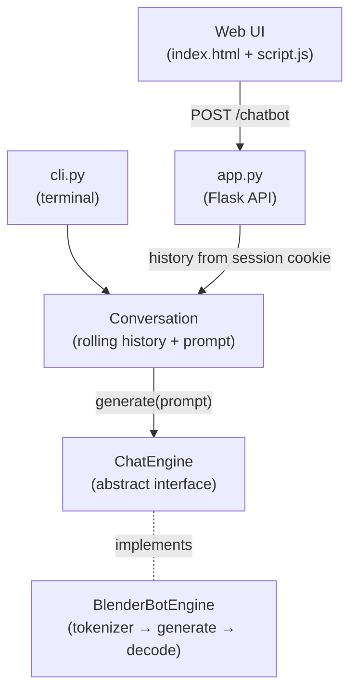

# 🤖 AI Chat Assistant


## 1. Overview

A conversational chatbot built with Python and Flask that runs the open-domain dialogue model
[Facebook BlenderBot-400M-distill](https://huggingface.co/facebook/blenderbot-400M-distill) fully locally.
It keeps a short conversational memory per user and can be used from a web chat UI, a JSON REST API or the terminal.

The model sits behind a common `ChatEngine` interface, so the dialogue engine can be swapped
(e.g. for another Hugging Face model or a hosted LLM) without touching the web or CLI layers.

## 2. Features

- Clean web chat UI with loading indicator and error messages.
- JSON REST endpoint (`POST /chatbot`) that other clients can consume.
- Short-term conversational memory (last 3 exchanges), isolated **per user** through a signed session cookie.
- CLI mode that reuses the same conversation logic as the web app.
- Pluggable engines through an abstract `ChatEngine` interface.
- Input validation on both the client and the server.
- Unit tests for the conversation logic and the Flask routes (model mocked), plus opt-in tests for the real model.

## 3. Demo

### Web Chat (empty state)


### Web Chat (example conversation)


### CLI Chat


### YouTube Video

[](https://youtu.be/UvrXL9aLWX8)

[Watch the demo on YouTube](https://youtu.be/UvrXL9aLWX8)

## 4. Architecture

The app follows a simple layered design. The Flask app and the CLI depend only on `Conversation`
and the `ChatEngine` abstraction; `BlenderBotEngine` is the concrete implementation.



Request flow:

1. The user types a message and presses **Enter**.
2. `script.js` sends `POST /chatbot` with `{ "prompt": "..." }`.
3. `app.py` validates the input and restores the user's history from the session cookie.
4. `Conversation` builds the prompt (`User: ... / Bot: ...` lines) and calls `engine.generate(prompt)`.
5. `BlenderBotEngine` tokenizes the prompt (max 128 tokens), generates up to 60 new tokens with
   nucleus sampling and decodes the reply.
6. The updated history is saved back to the session and the reply is returned as JSON.

## 5. Tech Stack

| Layer | Technology |
|---|---|
| Backend | Python, Flask, Flask-CORS |
| NLP / ML | Hugging Face Transformers, PyTorch |
| Model | `facebook/blenderbot-400M-distill` |
| Frontend | HTML, CSS, Bootstrap, vanilla JavaScript (Fetch API) |
| Testing | unittest |

## 6. Project Structure

```
chat-bot/
├── app.py                         # Flask app factory and routes
├── cli.py                         # Terminal chat
├── requirements.txt
├── test_api.http                  # Sample HTTP requests (VS Code REST Client)
├── assets/                        # Screenshots used in this README
├── chatbot/
│   ├── engine.py                  # ChatEngine abstract base class
│   ├── conversation.py            # Rolling history + prompt building
│   └── implementations/
│       └── blenderbot_engine.py   # BlenderBot implementation
├── static/
│   ├── css/style.css
│   ├── images/
│   └── js/script.js
├── templates/
│   └── index.html
└── tests/
    ├── test_app.py
    ├── test_conversation.py
    └── test_blenderbot_engine.py
```

## 7. Model

| Property | Value |
|---|---|
| Model | [`facebook/blenderbot-400M-distill`](https://huggingface.co/facebook/blenderbot-400M-distill) |
| Task | Open-domain dialogue |
| Type | Seq2Seq (encoder-decoder) |
| Parameters | ~400M |
| Max input tokens | 128 (older history is truncated) |
| Max output tokens | 60 |

Generation settings: `do_sample=True`, `temperature=0.6`, `top_p=0.85`, `repetition_penalty=1.3`,
`no_repeat_ngram_size=3`. These keep the replies varied but focused and avoid the repetitive loops
that small dialogue models tend to fall into.

- Inference runs under `torch.no_grad()` with the model in `eval()` mode.
- The model is downloaded on first run and cached locally; after that it works offline.
- `truststore` is used so the download also works behind corporate proxies that perform SSL inspection.

## 8. Running Locally

Prerequisites: Python 3.10+ and `pip`.

```bash
git clone https://github.com/yesithv/chat-bot.git
cd chat-bot

python -m venv .venv

# Windows
.venv\Scripts\activate
# Linux / macOS
source .venv/bin/activate

pip install -r requirements.txt
```

**Web app:**

```bash
python app.py
```

Open [http://localhost:5000](http://localhost:5000) in your browser.

> The first run downloads the BlenderBot model (~730 MB) from Hugging Face, so it may take a few minutes.

Optionally set a `SECRET_KEY` environment variable to sign the session cookie; otherwise a random
key is generated on each start (conversations reset when the server restarts).

**CLI:**

```bash
python cli.py
```

Type your message and press Enter. Type `exit` to quit.

To add a new engine, create a class that inherits from `ChatEngine`, implement
`generate(prompt: str) -> str` and pass an instance to `create_app()` in [app.py](app.py).

## 9. Running Tests

```bash
python -m unittest discover tests
```

The app and conversation tests use a fake engine, so they run in milliseconds without downloading the model.
To also run the tests that load the real BlenderBot model:

```bash
# Windows (PowerShell)
$env:RUN_MODEL_TESTS="1"; python -m unittest discover tests
# Linux / macOS
RUN_MODEL_TESTS=1 python -m unittest discover tests
```

## 10. API

### `POST /chatbot`

| Field | Type | Required | Description |
|---|---|---|---|
| `prompt` | string | Yes | User message (1–500 characters) |

Success (`200 OK`):

```json
{
  "response": "I think it depends on who you ask. Some people say it's happiness, others say purpose."
}
```

Error (`400 Bad Request`) when the message is missing, empty or too long:

```json
{
  "error": "Invalid message! Please type something."
}
```

Example:

```bash
curl -X POST http://localhost:5000/chatbot \
     -H "Content-Type: application/json" \
     -d '{"prompt": "What is the meaning of life?"}'
```

## 11. What I Learned

- Integrating a pre-trained seq2seq Transformer into a web application with `AutoTokenizer` and `AutoModelForSeq2SeqLM`.
- Tuning text generation (sampling, temperature, top-p, repetition penalties) to improve reply quality.
- Managing conversational context with a sliding window under a fixed token budget.
- Keeping per-user state in a stateless API with signed session cookies instead of global variables.
- Applying the Strategy pattern with abstract base classes to decouple the web/CLI layers from the model.
- Testing ML-backed applications by mocking the model, keeping slow model tests opt-in.

## 12. Future Improvements

- Stream responses token by token for real-time output.
- Select the engine through an environment variable instead of editing code.
- Add an engine for a modern instruction-tuned LLM (local or hosted) behind the same interface.
- Multi-language support.
- Containerize the app with Docker and deploy it to Hugging Face Spaces or Render.

## License

This project is licensed under the [MIT License](LICENSE).

## Author

**Yesith Valencia** — Software Engineer passionate about AI, Generative AI, and Cloud Technologies.

[GitHub Portfolio](https://yesithv.github.io/)
