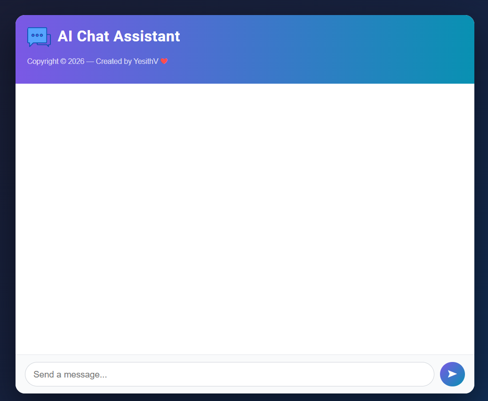
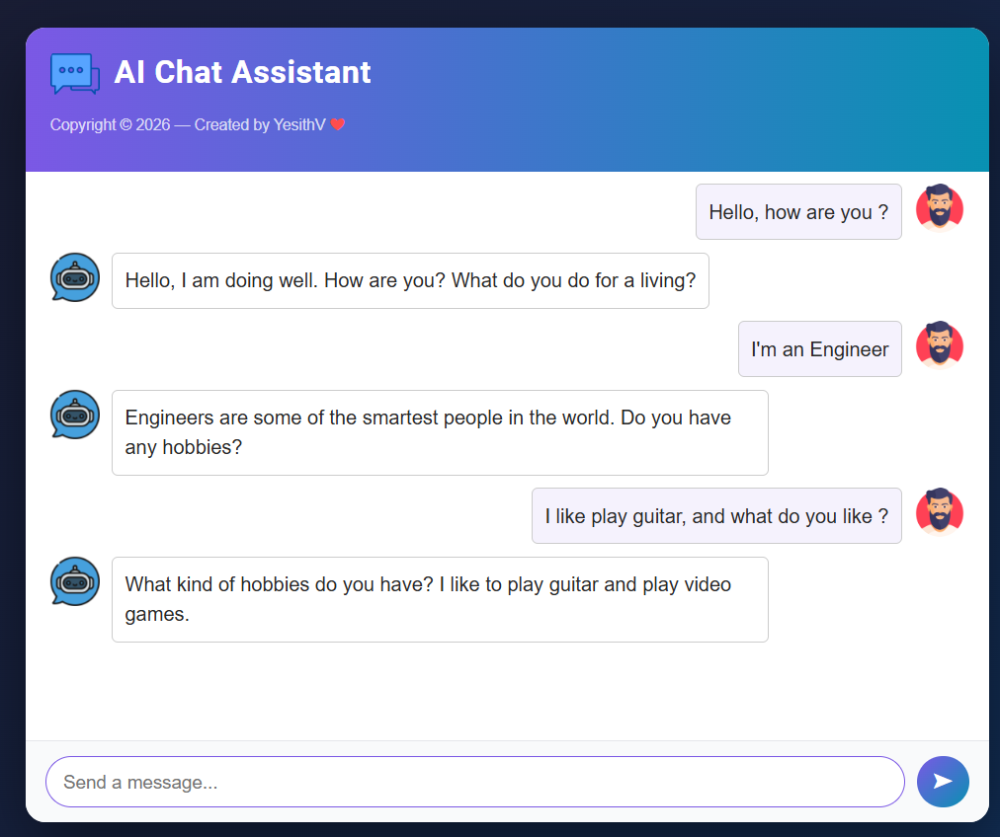
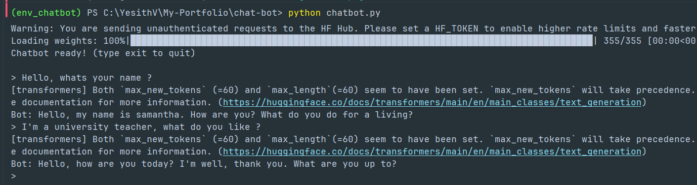
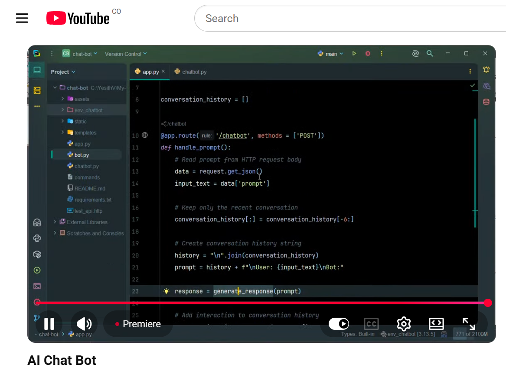

# 🤖 AI Chat Assistant


A conversational chatbot powered by [Facebook BlenderBot-400M-distill](https://huggingface.co/facebook/blenderbot-400M-distill), served through a Flask REST API with a responsive web UI.

---

## ✨ Features

- Conversational AI with short-term memory (last 6 exchanges)
- Web interface accessible via browser
- CLI mode for terminal interaction
- CORS enabled for cross-origin requests

---

## 🛠️ Tech Stack

| Layer | Technology |
|---|---|
| Language | Python 3.10 |
| AI Model | Facebook BlenderBot (`blenderbot-400M-distill`) |
| ML Framework | PyTorch |
| Model Hub | Hugging Face Transformers |
| Web Framework | Flask + Flask-CORS |
| Frontend | HTML, CSS, JavaScript (Fetch API) |

---

## 🏗️ Architecture

```text
                    ┌─────────────┐     ┌──────────────┐
                    │   app.py    │     │  chatbot.py  │
                    │ (Flask API) │     │    (CLI)     │
                    └──────┬──────┘     └──────┬───────┘
                           │                   │
                           └────────┬──────────┘
                                    ↓
                                 bot.py
                      (model + generate_response)
                                    ↓
              Conversation history + prompt string
                                    ↓
              AutoTokenizer   ← encodes prompt into tensors
                                    ↓
              BlenderBot.generate()  ← seq2seq with torch.no_grad()
                                    ↓
              tokenizer.decode()
                                    ↓
                           Response (text)
```

---

## 📂 Project Structure

```
chat-bot/
├── app.py           # Flask web server and /chatbot API endpoint
├── bot.py           # shared model: loads BlenderBot and exposes generate_response()
├── chatbot.py       # CLI mode (run directly in terminal)
├── requirements.txt # Python dependencies
├── templates/
│   └── index.html   # Chat UI
└── static/
    ├── script.js    # Frontend logic (fetch API calls)
    └── css/
        └── style.css
```

---

## 📋 Requirements

- Python 3.10+
- Dependencies:

```
torch==2.13.0
Flask==3.1.3
flask-cors==6.0.5
transformers==5.15.1
truststore==0.10.4
```

## 🚀 Installation

```bash
# Clone the repository
git clone <repo-url>
cd chat-bot

# Create and activate virtual environment
python -m venv env
source env/bin/activate        # Linux/macOS
env\Scripts\activate           # Windows

# Install dependencies
pip install -r requirements.txt
```

---

## 📖 Usage

### Web Server

```bash
python app.py
```

Open [http://localhost:5000](http://localhost:5000) in your browser.

**API endpoint:**

```http
POST /chatbot
Content-Type: application/json

{ "prompt": "Hello, how are you?" }
```

### CLI Mode

```bash
python chatbot.py
```

Type your message and press Enter. Type `exit` to quit.

---

## 🎬 Demo

### Web Chat (empty state)



### Web Chat (example conversation)



### CLI Chat



### YouTube Video

[](https://youtu.be/UvrXL9aLWX8)

[Watch the demo on YouTube](https://youtu.be/UvrXL9aLWX8)

```html
<iframe
    width="560"
    height="315"
    src="https://www.youtube.com/embed/UvrXL9aLWX8"
    title="YouTube video player"
    frameborder="0"
    allow="accelerometer; autoplay; clipboard-write; encrypted-media; gyroscope; picture-in-picture; web-share"
    referrerpolicy="strict-origin-when-cross-origin"
    allowfullscreen>
</iframe>
```

---


## 📝 Example

**Input:** `What's the meaning of life?`

**Output:**
```
I think it depends on who you ask. Some people say it's happiness, others say purpose.
```

---

## 🤖 Model

| Property | Value |
|---|---|
| Model | `facebook/blenderbot-400M-distill` |
| Task | Open-domain Dialogue |
| Type | Seq2Seq (encoder-decoder) |
| Framework | Hugging Face Transformers |
| Backend | PyTorch |
| Max input tokens | 128 |
| Max output tokens | 60 |
| Parameters | ~400M |

The model is downloaded automatically from Hugging Face on first run.

---

## 🎯 What I Practiced

- Integrating a pre-trained Transformer model into a real web application
- Working with the Hugging Face `transformers` API (`AutoTokenizer`, `AutoModelForSeq2SeqLM`)
- Building a REST API with Flask and connecting it to a vanilla JS frontend
- Managing conversational context with sliding window history
- Decoupling model logic into a shared module consumed by both the API and CLI

---

## 🔮 Roadmap

- [ ] Streaming responses for real-time output
- [ ] Multi-language support
- [ ] REST API documentation with Swagger
- [ ] Deployment on Hugging Face Spaces or Render
- [ ] Support for larger dialogue models (BlenderBot-3B, DialoGPT)

---

## 📜 License

This project is licensed under the MIT License.

---

## 👨‍💻 Author

**Yesith Valencia**

Software Engineer passionate about AI, Generative AI, and Cloud Technologies.

[GitHub Portfolio](https://yesithv.github.io/)
